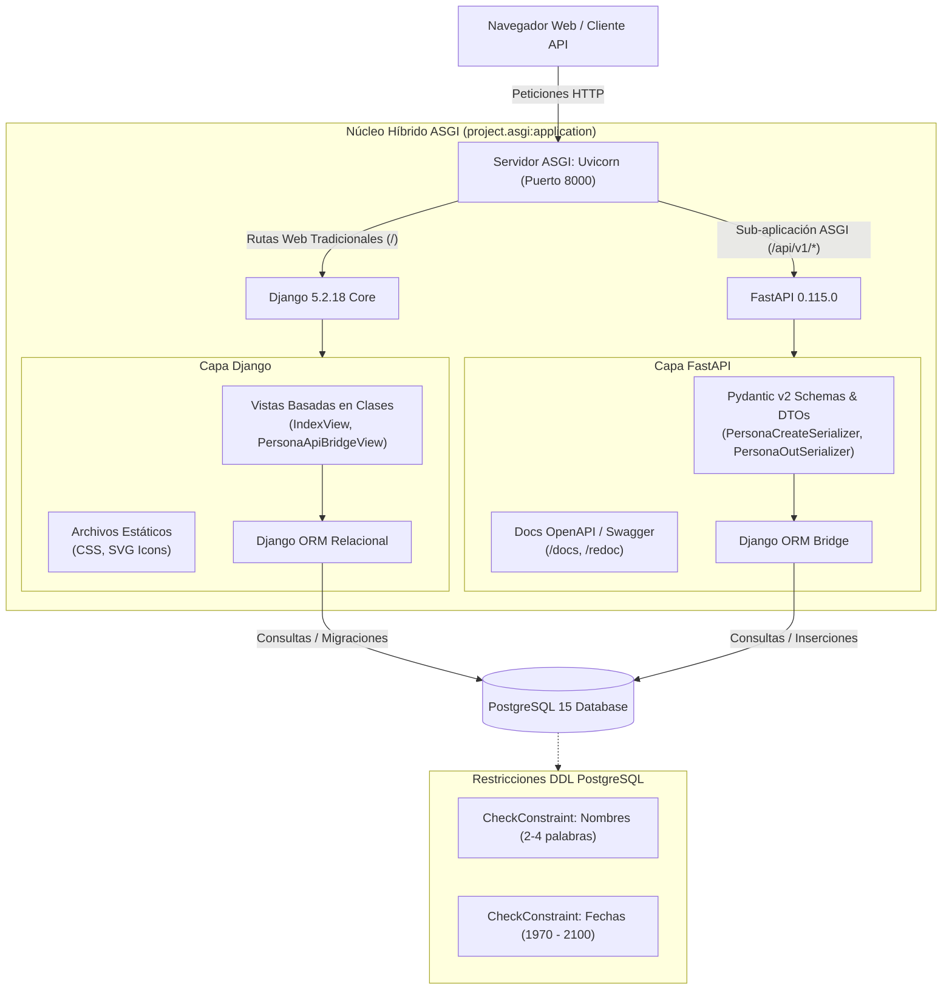

# Persona Management Platform — Hybrid Django 5 & FastAPI

Plataforma empresarial de gestión de registros implementada sobre una arquitectura monolítica híbrida **Django 5 + FastAPI**, servida de forma unificada mediante el estándar ASGI con **Uvicorn** y respaldada por **PostgreSQL 15** en contenedores Docker Alpine.

---

## Características Principales

- **Arquitectura Híbrida ASGI**: Combina la robustez del ORM, sistema de migraciones y vistas basadas en clases de Django 5 con la velocidad de ejecución y validación asíncrona de FastAPI bajo el prefijo de ruta `/api/v1/`.
- **Validación de Datos en Tres Capas**:
  1. *Frontend*: Validación regex en tiempo real en JavaScript y controles de formulario HTML5.
  2. *Backend*: Esquemas Pydantic v2 con validadores estrictos y validadores de modelo en Django.
  3. *Base de Datos*: Restricciones de integridad nativas `CheckConstraint` aplicadas a nivel de esquema DDL en PostgreSQL.
- **Serialización y DTOs Estrictos**: Mapeo desacoplado con Pydantic (`PersonaCreateSerializer`, `PersonaOutSerializer`) garantizando contratos de API inmutables y documentación OpenAPI automática en `/docs`.
- **Diseño UI/UX Corporativo**: Sistema de diseño con paleta de 5 familias de color, modo claro, iconografía SVG vectorial, espaciado ergonómico de 30px entre formulario y tabla, y notificaciones Toast dinámicas.
- **Seguridad y Cero Credenciales Quemadas**: Carga dinámica de configuración desde `.env` ignorado por control de versiones, protección CSRF y sanitización estricta de entradas.
- **Contenedorización Hardened**: Dockerfile basado en `python:3.10-alpine`, con actualización de paquetes del sistema y cero vulnerabilidades críticas reportadas en Docker Scout.
- **Pipeline CI/CD Completo**: Flujo automatizado en GitHub Actions con ejecución de pruebas automatizadas sobre PostgreSQL 15 real, compilación de imagen OCI y empaquetado de artefactos.

---

## Arquitectura del Sistema



---

## Estructura del Proyecto

```text
n_practica_3/
├── .github/
│   └── workflows/
│       └── ci.yml             # Pipeline de CI/CD para GitHub Actions
├── app/
│   ├── migrations/            # Migraciones DDL de base de datos
│   ├── static/
│   │   └── css/
│   │       └── styles.css     # Hoja de estilos desacoplada y responsiva
│   ├── templates/
│   │   └── app/
│   │       └── index.html     # Plantilla principal con UI corporativa y Toast
│   ├── api.py                 # Enrutador y endpoints de FastAPI (/api/v1)
│   ├── models.py              # Modelo de datos Persona con validadores nativos
│   ├── serializers.py         # Serializadores y esquemas Pydantic v2
│   ├── tests.py               # Suite de 10 pruebas automatizadas
│   ├── urls.py                # Enrutamiento de URLs de Django
│   └── views.py               # Vistas basadas en clases (CBVs)
├── project/
│   ├── asgi.py                # Configuración ASGI híbrida (Django + FastAPI mount)
│   ├── settings.py            # Configuración de Django cargada desde .env
│   ├── urls.py                # Enrutador principal de Django
│   └── wsgi.py                # Punto de entrada WSGI tradicional
├── .env.example               # Plantilla de variables de entorno seguras
├── .gitignore                 # Exclusión de archivos sensibles y entornos virtuales
├── deploy-notes.md            # Guía técnica de arquitectura y despliegue
├── Dockerfile                 # Imagen Docker hardened basada en Alpine Linux
├── docker-compose.yml         # Orquestación de servicios web y base de datos
├── entrypoint.sh              # Script de arranque con espera activa de PostgreSQL
├── manage.py                  # CLI de administración de Django
└── requirements.txt           # Dependencias fijadas del proyecto
```

---

## Requisitos Previos

- **Python**: Versión 3.10.x instalada.
- **PostgreSQL**: Instancia 15 o superior activa (o Docker para ejecutarla en contenedor).
- **Docker & Docker Compose**: Versión 24.0+ recomendada para despliegue en contenedores.

---

## Instalación y Ejecución Local

### 1. Clonar el Repositorio
```bash
git clone -b ci-setup https://github.com/TU_USUARIO/TU_REPOSITORIO.git
cd n_practica_3
```

### 2. Configurar Entorno Virtual
```bash
python -m venv .venv

# En Windows (PowerShell):
.venv\Scripts\Activate.ps1

# En Linux/macOS:
source .venv/bin/activate
```

### 3. Instalar Dependencias
```bash
python -m pip install --upgrade pip
pip install -r requirements.txt
```

### 4. Configurar Variables de Entorno
Copia el archivo `.env.example` como `.env` y ajusta las credenciales locales:
```bash
cp .env.example .env
```

Contenido base del `.env`:
```env
DEBUG=True
SECRET_KEY=django-insecure-local-dev-secret-key-change-in-production
ALLOWED_HOSTS=localhost,127.0.0.1,0.0.0.0
POSTGRES_DB=practican3
POSTGRES_USER=postgres
POSTGRES_PASSWORD=postgres
DB_HOST=localhost
DB_PORT=5432
```

### 5. Aplicar Migraciones de Base de Datos
```bash
python manage.py migrate
```

### 6. Ejecutar Servidor de Desarrollo

#### Opción A: Servidor Estándar de Django
```bash
python manage.py runserver 127.0.0.1:8000
```

#### Opción B: Servidor Asíncrono ASGI con Uvicorn (Recomendado para FastAPI)
```bash
uvicorn project.asgi:application --host 127.0.0.1 --port 8000 --reload
```

Acceso al sistema:
- **Interfaz Web Principal**: [http://127.0.0.1:8000/](http://127.0.0.1:8000/)
- **Documentación OpenAPI (Swagger)**: [http://127.0.0.1:8000/docs](http://127.0.0.1:8000/docs)
- **Documentación ReDoc**: [http://127.0.0.1:8000/redoc](http://127.0.0.1:8000/redoc)

---

## Despliegue con Docker y Docker Compose

El despliegue con contenedores automatiza la creación de la red aislada, el volumen de datos persistente para PostgreSQL y la ejecución de migraciones en el arranque.

### 1. Levantar Servicios
```bash
docker compose up -d --build
```

### 2. Inspeccionar Logs del Servicio Web
```bash
docker compose logs -f web
```

### 3. Detener Servicios
```bash
docker compose down
```

---

## Especificación de la API REST

Todos los endpoints REST se encuentran documentados interactivamente en `/docs` vía OpenAPI.

| Método | Endpoint | Descripción | Códigos de Estado |
|---|---|---|---|
| `GET` | `/api/v1/personas/` | Lista todas las personas registradas | `200 OK` |
| `POST` | `/api/v1/personas/` | Registra una nueva persona validando nombre y fecha | `201 Created`, `400 Bad Request`, `422 Unprocessable` |
| `GET` | `/api/v1/health` | Verificación de estado de salud del servicio | `200 OK` |
| `PUT / DELETE` | `/api/v1/personas/` | Métodos mutadores no permitidos | `405 Method Not Allowed` |

### Ejemplo de Petición `POST /api/v1/personas/`
```json
{
  "nombre": "Carlos Alberto Mendoza",
  "fecha_nacimiento": "1994-08-15"
}
```

### Ejemplo de Respuesta Exitosa (`201 Created`)
```json
{
  "id": 1,
  "nombre": "Carlos Alberto Mendoza",
  "fecha_nacimiento": "1994-08-15"
}
```

---

## Ejecución de Pruebas Automatizadas

El sistema cuenta con una suite completa de pruebas unitarias y de integración que verifican la integridad del modelo, los serializadores Pydantic, los endpoints de la API y las vistas basadas en clases.

```bash
python manage.py test -v 2
```

Resultado esperado:
```text
Ran 10 tests in 0.350s

OK
```

---

## Pipeline CI/CD

El pipeline en GitHub Actions (`.github/workflows/ci.yml`) se dispara automáticamente ante `push` o `pull_request` en las ramas `ci-setup` y `main`:

1. **Job 1: `test`**: Levanta un servicio PostgreSQL 15, instala dependencias, ejecuta migraciones y corre la suite completa de 10 pruebas.
2. **Job 2: `build-docker`**: Solo si las pruebas pasan al 100%, compila la imagen Docker con Alpine, la empaqueta en un archivo `.tar` y publica el artefacto descargable en el repositorio.
